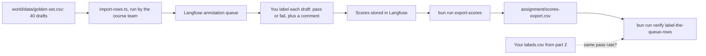

# Review answers with the Langfuse queue

## The problem

In part 2 you labelled 40 drafts in a spreadsheet. It worked. But a spreadsheet does not scale. Two reviewers overwrite each other. Nobody can see which drafts are still waiting. The label sits far from the draft it describes.

Teams that run AI features in production use a tool for this. In this part you do the same job in that tool. It is called **Langfuse**. It is free and open source.

For example, you open draft T135 in Langfuse. The request and the draft are on one screen. You press pass or fail, type one line of reason, and the next draft appears.

This part is short. You redo one thing you already built by hand. The earlier parts stay exactly as they are.

## Why it matters

A spreadsheet is the right place to learn. A queue is the right place to keep working once more than one person reviews drafts. You make the same labels here that you made by hand. So you can check that the tool gives the same pass rate.

An **annotation queue** is a list of items that wait for a human label. Each item shows the draft. You add a label and a comment. Langfuse stores both next to the draft.



## What we teach

- How to open a queue and label rows one by one.
- How the label and the comment you gave show next to each row.
- How to export the scores and compare the pass rate with your spreadsheet.

## Steps

| Step                                                              | Minutes | You make                       | The check reads                                                   |
| ----------------------------------------------------------------- | ------- | ------------------------------ | ----------------------------------------------------------------- |
| [label-the-queue-rows](01-label-the-queue-rows/problem/README.md) | 20      | `assignment/scores-export.csv` | 40 ids of `golden-set.csv`, each once, each labelled pass or fail |

## Options

Langfuse Cloud is the default, so you need no Docker. You can host Langfuse on your own laptop with `assignment/docker-compose.yml`. It starts 6 containers and needs about 2 GiB of memory.

The other choice is Arize Phoenix, hosted on your own laptop.

- **Choose when:** the data must stay on your laptop and memory is short. Phoenix is one container and needs far less memory than Langfuse.
- **Trade-off:** Phoenix uses the Elastic License 2.0. That is free to use, but its source is open to read, not open source in the strict sense. It also needs Docker, which Langfuse Cloud does not.

## Walkthrough

You need a Langfuse account first. The step shows you where to click. Then run the commands below.

```bash
bun run export-scores
```

Expect: `Wrote assignment/scores-export.csv: 40 rows.` once you have labelled every draft in the queue.

```bash
bun run verify label-the-queue-rows
```

Expect: `Done. All 2 rules pass.` once the export holds one label for each of the 40 drafts.

When the step passes, check the whole part:

```bash
bun run verify part review-answers-with-the-langfuse-queue
```

Expect: `Part review-answers-with-the-langfuse-queue is done: 1/1 steps pass.`

## Assignment

This part is optional in the live session. It is expected as homework. The full task, the Done-when lines and the rubric are in [assignment/README.md](../../assignment/README.md).

## Finished

You made the same labels in a tool that teams use at work. For example, the sample answer has 40 labels, and its pass rate matches the spreadsheet from part 2.
